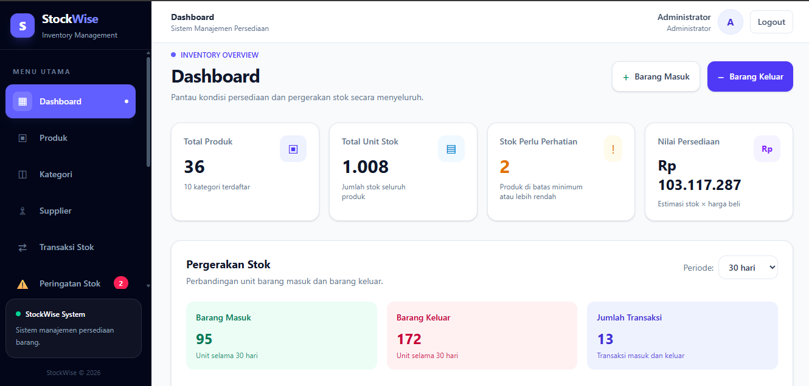

# StockWise — Inventory Management System

Aplikasi manajemen persediaan barang berbasis web yang dibangun menggunakan **Laravel, PHP, dan MySQL** untuk membantu pengelolaan data produk, pencatatan transaksi stok, pemantauan persediaan, serta penyusunan laporan inventaris.

StockWise dikembangkan sebagai proyek portofolio yang menggabungkan pengembangan aplikasi web, perancangan basis data relasional, validasi data, dan pengolahan laporan.

## Preview Aplikasi

Dashboard StockWise menyajikan ringkasan informasi persediaan untuk membantu pengguna memantau kondisi stok barang.



Dokumentasi visual lainnya tersedia di [folder screenshot aplikasi](docs/screenshot/).

## Fitur Utama

### Dashboard

- Menampilkan ringkasan data produk dan kondisi persediaan.
- Memantau produk yang mencapai atau berada di bawah batas stok minimum.

### Manajemen Data Master

- Mengelola data produk dengan fitur tambah, lihat, ubah, dan hapus.
- Mengelola kategori dan supplier.
- Mencatat SKU, satuan, harga beli, harga jual, stok awal, dan stok minimum.
- Mengimpor data produk dari file Excel menggunakan template yang tersedia.

### Transaksi Persediaan

- **Stock In:** pencatatan barang masuk.
- **Stock Out:** pencatatan barang keluar beserta informasi penerima.
- **Stock Adjustment:** penyesuaian stok berdasarkan kondisi aktual dan alasan penyesuaian.
- Menghitung stok berdasarkan stok awal dan riwayat transaksi.
- Memvalidasi transaksi barang keluar untuk mencegah stok negatif.

### Laporan dan Pengolahan Data

- Laporan stok barang dan transaksi persediaan.
- Laporan stok berdasarkan tanggal historis yang dipilih.
- Filter data untuk mempermudah pencarian dan analisis.
- Ekspor laporan stok, transaksi, dan ringkasan aktivitas ke format CSV.
- Impor produk dari Excel dengan validasi SKU duplikat, kategori, supplier, dan format nilai.

### Autentikasi dan Pengelolaan Pengguna

- Fitur login dan logout.
- Pembagian hak akses Admin dan Staff.
- Pengelolaan akun pengguna oleh Admin.
- Pencatatan aktivitas sistem melalui fitur _activity logs_.

## Teknologi

| Teknologi      | Penggunaan                           |
| -------------- | ------------------------------------ |
| PHP            | Bahasa pemrograman backend           |
| Laravel        | Framework aplikasi web               |
| Blade          | Template engine                      |
| Tailwind CSS   | Styling antarmuka                    |
| MySQL          | Basis data relasional                |
| Laravel Excel  | Impor dan pemrosesan file Excel      |
| PhpSpreadsheet | Pemrosesan spreadsheet               |
| Git & GitHub   | Version control dan pengelolaan kode |
| Laragon        | Lingkungan pengembangan lokal        |

## Struktur Basis Data

StockWise memisahkan data master, transaksi persediaan, dan aktivitas sistem untuk menjaga pengelolaan data tetap terstruktur serta mendukung perhitungan stok dan pembuatan laporan.

| Tabel               | Deskripsi                        |
| ------------------- | -------------------------------- |
| `users`             | Data pengguna dan hak akses      |
| `categories`        | Kategori produk                  |
| `suppliers`         | Data pemasok                     |
| `products`          | Data master produk dan stok awal |
| `stock_ins`         | Riwayat barang masuk             |
| `stock_outs`        | Riwayat barang keluar            |
| `stock_adjustments` | Riwayat penyesuaian stok         |
| `activity_logs`     | Riwayat aktivitas sistem         |

Diagram hubungan antartabel dapat dilihat pada [Entity Relationship Diagram (ERD)](docs/erd.md).

## Instalasi

### Persyaratan

Pastikan perangkat telah memiliki:

- PHP dan ekstensi yang dibutuhkan oleh dependency proyek.
- Composer.
- MySQL atau MariaDB.
- Node.js dan npm.
- Git.

### 1. Clone repository

```bash
git clone https://github.com/Hariss1011/StockWise.git
cd StockWise
```

### 2. Instal dependency

```bash
composer install
```

### 3. Konfigurasikan environment

Salin `.env.example` menjadi `.env`.

Windows PowerShell:

```powershell
Copy-Item .env.example .env
```

Buat application key:

```bash
php artisan key:generate
```

### 4. Konfigurasikan database

Buat database MySQL dengan nama `stockwise`, kemudian sesuaikan konfigurasi pada file `.env`.

Contoh konfigurasi lokal:

```env
APP_NAME=StockWise
APP_TIMEZONE=Asia/Jakarta

DB_CONNECTION=mysql
DB_HOST=127.0.0.1
DB_PORT=3306
DB_DATABASE=stockwise
DB_USERNAME=root
DB_PASSWORD=
```

Sesuaikan nama database dan kredensial dengan konfigurasi lingkungan lokal.

### 5. Jalankan migration dan seeder

```bash
php artisan migrate --seed
```

Perintah ini menyiapkan struktur tabel dan data awal berdasarkan migration serta seeder yang tersedia. Gunakan seeder pada database pengembangan yang sesuai, dan periksa isinya sebelum menjalankannya pada database yang telah memiliki data.

### 6. Instal dan build aset frontend

```bash
npm install
npm run build
```

### 7. Jalankan aplikasi

```bash
php artisan serve
```

Akses aplikasi melalui:

http://127.0.0.1:8000

Akun untuk masuk mengikuti konfigurasi pengguna yang tersedia pada lingkungan pengembangan.

## Validasi dan Pengujian

Pengujian impor produk mencakup skenario berikut:

- SKU duplikat.
- Kategori atau supplier yang tidak ditemukan.
- Harga dengan format tidak valid.
- Nama produk kosong.
- Data produk valid.
- Penolakan impor ketika terdapat data tidak valid.

Skenario tersebut telah diuji selama proses pengembangan. Fitur lainnya diuji sesuai kebutuhan dan aturan yang diterapkan pada masing-masing modul.

## Data Demonstrasi

Data contoh digunakan untuk pengujian fitur dan demonstrasi alur kerja StockWise. Data tersebut ditujukan untuk keperluan pengembangan dan portofolio, bukan sebagai representasi transaksi perusahaan nyata.

## Rencana Pengembangan

- Menyempurnakan dokumentasi hasil pengujian.
- Menambahkan visualisasi tren pergerakan stok.
- Mengembangkan analisis produk berdasarkan tingkat perputaran persediaan.
- Menyediakan demo aplikasi yang dapat diakses secara daring.

## Author

**Akhmad Haris**

- GitHub: [@Hariss1011](https://github.com/Hariss1011)
- Repository: [StockWise — Inventory Management System](https://github.com/Hariss1011/StockWise)
